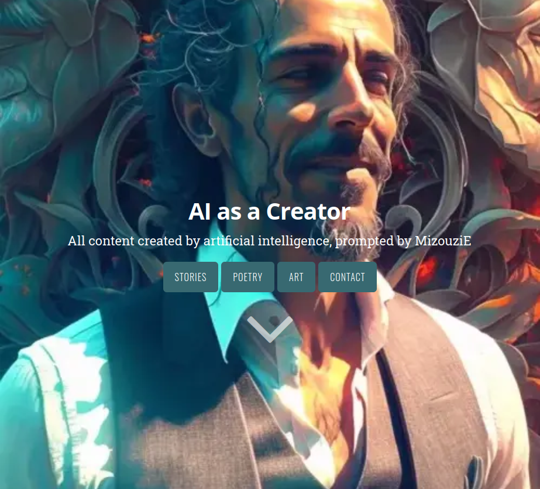

# New Side Project - AI as a Creator

I am excited to announce the launch of a side-project that acts as a sort of recycling plant for the content I will be generating over the course of a current work project. It will be like a document to what I learn about interacting with the machine learning language model _Davinci_ from OpenAI and the image generating model from Midjourney.

I was really taken aback by the abilities of these tools, much like everyone else that have tried them, and when I was told that I would get free reign to try out the language model and build something off the back of it I was excited to say the least.

## The Project

The project itself I have named **AI as a Creator** and you can view the [site here](https://ai-as-a-creator.github.io). The purpose of it is simply to show what comes out from the various prompts and re-tweaked prompts that I will be using while working with the model and also whatever images are produced when I go and have some fun with Midjourney.

I am a huge fan of the static site generator [Hugo](gohugo.io) and have used that to start this site with the help of a theme by [Jan Raasch](https://www.janraasch.com/) who I should probably apologise to because I removed the little "made with ♥ by Jan Raasch" from the footer because I couldn't stand how it looked 🙈 I do, however, have it written down several times in my notes that if this even generates any revenue then I promise to pay a fair percentage towards their company.

### The past

The job that churns out the bi-product that I am to turn into this project has me writing an application in Go, which is fast becoming my second favourite language after SQL. As I am making small tweaks here and there I need to constantly test that the application behaves as expected and that involves interacting with the OpenAI API, which has a **very** nice library for use with Go and I must mention that it has been one of the most painless, if not one of the most down-right enjoyable experiences I've had since I began developing.

It has been surprisingly inexpensive to use too. The table below shows some of my whole team's usage and even the biggest spike on the 10th of February where we tried to push the limits to see where the ceiling was ended up only costing $0.23 which is almost nothing!

### The present

The site itself is _mostly_ a single page kind of thing, but there are a couple of supplementary pages for the moment that just provide a little extra context if desired.

There is not a huge amount of content thus far, but I thought it was enough to make a start. It was also a great excuse for me to practice my front end abilities even just in the realms of HTML, CSS and minimal JS. As a predominantly back end developer, I need to seize every opportunity I get! That mixed with my undeniable soft-spot for the arts meant that I just couldn't sit on this pile of genuine creativity, it had to be shared.

It is a collection of:
- Stories
- Poems
- Art
- Jokes
- Instructions

### The future

I plan to keep on adding to it as the content piles up in my own computer, hoping that the quality of it also improves along the way even if I do already think the very first things I've generated are amazing to some degree.

The site will definitely be a rolling project and I already keep a notepad where I can scribble down ideas as they come to me. For example:

> Each of the entries should have a button at the bottom or the side that _reveal_ the prompt that was used to generate that particular piece.

> Each entry should have a button to share **just** that entry, perhaps meaning that I will have to create an individual page for each entry and just display them all as one.

The possibilities are quite exciting and having a seemingly endless stream of content really takes the pressure off from having to write it like I write the articles on this site. I hope to explore and learn a great deal in terms of design, UI and UX.

## Outcome

Honestly, I have no idea what the ultimate outcome will be. I'm certainly not holding my breath for any monetary gains as this is purely an artistic endevour and I'm already very happy with the things I've learnt about front end development just in these first two days.

But that is exactly it... It's just the first two days, so there couldn't possibly be any way to tell what comes of this. All I can hope is that someone out there finds what has been produced as interesting and enjoyable as I do and will make my sharing it worthwhile.

Go take a look and bookmark the page so you can check in after a while and see where this journey has taken the project. Or better yet, share this post with someone that **you** think would really enjoy what is on show.
